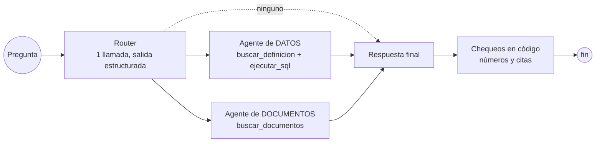

# RAG multiagente: router + dos agentes especialistas

Asistente para analistas de un banco. Responde preguntas que mezclan **datos estructurados** y **documentos**, por ejemplo:

> "¿Cuántos clientes activos tienen préstamos en mora, y qué dice la política sobre cómo contactarlos?"

El diseño busca un punto medio: tener **dos agentes especialistas y un router liviano** en LangGraph, sin un supervisor que replanifique ni un validador con LLM.

## La idea



- **Router**: no es un agente. Es una sola llamada al LLM que decide si la pregunta necesita datos, documentos, ambos o ninguno. Con `Send`, los dos agentes corren **en paralelo**, y LangGraph espera a ambos antes de pasar a `responder`.
- **Agente de datos**: es un agente ReAct con dos tools, `buscar_definicion` y `ejecutar_sql`. La parte semántica y la de SQL van en el mismo agente porque siempre se usan en cadena: primero la definición oficial y después la consulta.
- **Agente de documentos**: es un RAG con su propia tool de búsqueda, que devuelve cada fragmento con su fuente (título y sección).
- **Respuesta final**: un nodo que combina los dos resultados y redacta.
- **Chequeos**: código simple, sin LLM. Verifica que todo número de la respuesta salga de la salida de alguna tool, y que la respuesta cite la fuente cuando se usaron documentos. Si algo no cuadra, agrega una advertencia.

Todo el flujo está en un solo archivo: [graph.py](src/multi_agent_rag/graph.py).

## Guardrails

Están dentro de las tools ([tools.py](src/multi_agent_rag/tools.py)), no en los prompts:

- **`ejecutar_sql`**: acepta una sola sentencia `SELECT`, solo sobre las tablas del catálogo, sin columnas sensibles y con límite de filas. La base se abre en modo solo lectura, y un autorizador de SQLite bloquea cualquier operación que no sea leer las tablas y columnas permitidas ([database.py](src/multi_agent_rag/database.py)). Si la consulta tiene un error, el agente lo recibe y la corrige.
- **`buscar_documentos`**: filtra por el rol del usuario *antes* de buscar. La línea `Acceso:` de cada documento define qué roles pueden verlo. El rol se pasa como contexto de ejecución y el LLM no lo ve.
- **Máximo de pasos** en cada agente, con `recursion_limit` al invocarlo (`MAX_PASOS_AGENTE`). Si un agente entra en bucle, se corta y la respuesta lo informa.
- **Tests offline**: los agentes ReAct reales corren con un chat model falso que hace tool calling, así que no hace falta API key.

## Capa semántica

Vive en [data/ontologia.json](data/ontologia.json) y se carga como grafo de conocimiento (`networkx`). Los conceptos son nodos y las relaciones son aristas (`ES_UN`, `TIENE` con su join, `APLICA_A`, `REGULADA_POR`…). Cada concepto trae:

- su definición y su expresión SQL oficial. Por ejemplo, *cliente activo* = `fecha_ultimo_movimiento >= date('now','-90 days')`;
- datos de gobierno: steward, confianza (0–100), si está certificado y versión.

El agente de datos la consulta con `buscar_definicion`, y el [servidor MCP](src/multi_agent_rag/mcp_server.py) la expone a otros agentes. Así, si cambia una definición, todos los consumidores reciben la versión nueva sin tocar su código.

## Estructura

```
src/multi_agent_rag/
  graph.py            # estado, router, agentes, respuesta, chequeos y grafo
  tools.py            # buscar_definicion, ejecutar_sql, buscar_documentos (con guardrails)
  semantic_layer.py   # ontología como grafo de conocimiento
  database.py         # datos sintéticos + ejecución segura de SQL
  retriever.py        # BM25 con filtro por rol
  llm.py              # modelo según proveedor (Anthropic / OpenAI / Azure OpenAI)
  cli.py | api.py | mcp_server.py
data/                 # ontología + documentos (banco ficticio)
eval/ + scripts/      # set de evaluación y script de regresión
tests/                # tests offline con LLMs falsos
```

## Puesta en marcha

```bash
python -m venv .venv
.venv\Scripts\activate             # Windows  (Linux/Mac: source .venv/bin/activate)
pip install -e ".[dev,anthropic]"  # o .[openai] para OpenAI / Azure OpenAI
cp .env.example .env               # completar modelo y API key
mar init-db                        # base SQLite con 2000 clientes sintéticos
```

## Uso

```bash
mar preguntar "¿Cuántos clientes activos tienen préstamos en mora, y qué dice la política sobre cómo contactarlos?" -v
mar preguntar "¿Cómo se contacta a un cliente en mora?" --rol comercial   # este rol no ve la política de cobranza
mar chat -v
```

Con `-v` se ve la ruta elegida, el SQL ejecutado, las fuentes y lo que devolvió cada agente.

**API HTTP**: `pip install -e ".[api]"` y `uvicorn multi_agent_rag.api:app --reload`. Se consulta con `POST /preguntar {"pregunta": "...", "rol": "analista"}`.

**Servidor MCP**: `pip install -e ".[mcp]"` y `python -m multi_agent_rag.mcp_server`. Tools disponibles: `buscar_conceptos`, `obtener_concepto`, `listar_conceptos`, `esquema_tablas` y `preguntar_asistente`.

## Calidad

```bash
pytest                       # offline, sin API key
python scripts/evaluar.py    # regresión con el LLM real
```

La evaluación compara cada número contra una **consulta SQL de referencia**. También verifica que se haya recuperado la fuente esperada, que la respuesta no filtre datos personales y que el asistente diga "no sé" en preguntas fuera de alcance. Para trazas en producción alcanza con `LANGSMITH_TRACING=true`.

## Cuándo conviene esta versión

- Cuando hay dos tipos de fuentes bien distintas (datos estructurados y documentos), cada una con sus reglas y su prompt.
- Cuando el paralelismo ayuda a bajar la latencia.
- Cuando se quiere cambiar o reutilizar un agente sin tocar el otro. Por ejemplo, usar el agente de datos en otro asistente, o un modelo más barato para documentos (`LLM_MODEL_RAPIDO`).

Cada agente tiene pocas tools y un prompt corto, el flujo es fijo y fácil de leer, y no hay un supervisor que replanifique.

## Cómo llevarlo a producción

| Demo | Producción |
|---|---|
| SQLite sintético | BigQuery / Synapse / Databricks con usuario de solo lectura |
| `ontologia.json` | Grafo en Neo4j / Neptune, ontología basada en FIBO o BIAN, sincronizada con Collibra / Purview |
| BM25 en memoria con `Acceso:` | Azure AI Search con búsqueda híbrida y security trimming por grupo de Entra ID |
| CLI / FastAPI local | FastAPI en AKS o Azure Functions, Azure OpenAI dentro del tenant, Key Vault |

> Todos los datos, documentos y políticas del repo son ficticios.
